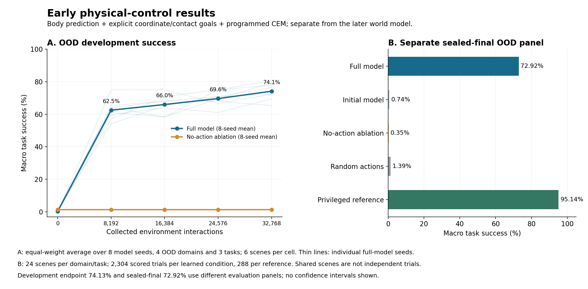

# DevBaby: Synthetic Physical Learning and World-Model Audits

[中文](README.zh-CN.md) · Evidence snapshot: **2026-11-11**

DevBaby studies learning physical interaction from fully simulated experience: vision, action, proprioception, sound and synthetic caregiver speech. The intended outcomes are success in new physical situations and learning speed, rather than speech recognition or claims of consciousness.

**Two model generations must be distinguished.** The early body-prediction controller has completed physical-success and adaptation experiments. The later image-based world-model prototype has an audited training defect; its repair has passed a single-step mechanism test, but repaired end-to-end training and generalization remain unverified.

## Current findings

| Study | Verified observation | Interpretation boundary |
|---|---|---|
| Early body prediction + supplied CEM controller | OOD development success rises from 0.35% to 74.13%; separate sealed OOD endpoint is 72.92% | Explicit task/spatial goals and programmed grasp/control structure; not autonomous object-level world modeling |
| Early adaptation supplement | At +2,048 interactions: frozen 47.87%, full update 38.85%, replay 44.79%, history 59.29% | Eight seeds; protocol-specific macro averages; simple feedback control remains strong |
| Exploration pilot | 12 conditions × eight paired scenes; contact and displacement coverage vary | No neural training; no established information or learning-speed law |
| Later frozen world-model audit | Object prediction is worse than image persistence; no consistent action-input advantage | Old training is compromised; descriptive failure evidence only |
| Separate 200-update FP32 comparison | Both loss variants remain worse than persistence on development object prediction | One seed, small inspected dataset; not physical-task success |
| Parameter/cache audit | Cache-on reproduces missing gradients; cache-off restores all eight GRU parameter updates | No complete repaired GradScaler/retry/resume regression or full retraining yet |



The left and right panels use different evaluation sets. Their endpoints must not be connected into one curve. Random and privileged references have no independent training seeds. See [early experiments](docs/en/EARLY_EXPERIMENTS.md) for denominators, uncertainty, task definitions and strong feedback baselines.

## What is established

- A fully synthetic multimodal collection and evaluation pipeline, with annotations separated from learner inputs.
- Learning and limited physical transfer in the earlier, explicitly structured body-control system; naive continued adaptation can reduce success.
- Within the supplement, replay partially mitigates that degradation and an explicit history baseline performs better than the main Baby comparisons. This does not isolate a universal causal mechanism.
- A reproducible later training failure that aggregate loss/gradient checks missed. Full parameter records show 26 missing-gradient tensors under the failing GPU condition, including eight recurrent and 18 encoder tensors.

No validated scaling law, general object-manipulation competence, causal benefit of caregiver language, or consciousness result is claimed. The latest world-model fix does not automatically solve the separate FP32 prediction failure.

## Documentation

| Document | English | 中文 |
|---|---|---|
| Completed early experiments and adaptation | [Read](docs/en/EARLY_EXPERIMENTS.md) | [阅读](docs/zh/EARLY_EXPERIMENTS.md) |
| Results and conclusions | [Read](docs/en/RESULTS.md) | [阅读](docs/zh/RESULTS.md) |
| Methods, labels and metric definitions | [Read](docs/en/METHODS.md) | [阅读](docs/zh/METHODS.md) |
| Training defect and repair boundary | [Read](docs/en/TRAINING_BUG.md) | [阅读](docs/zh/TRAINING_BUG.md) |
| Progress and experiment ledger | [Read](docs/en/PROGRESS.md) | [阅读](docs/zh/PROGRESS.md) |
| Limitations and next experiments | [Read](docs/en/NEXT_STEPS.md) | [阅读](docs/zh/NEXT_STEPS.md) |

Machine-readable results: [data dictionary](results/README.md). Sources and access limits: [provenance](provenance/README.md). Review/commit instructions: [CONTRIBUTING.md](CONTRIBUTING.md).

## Reproduce this evidence snapshot

From this directory, Python 3.10+ can verify the included data and tables without a GPU, network access or training dependencies:

```bash
python3 scripts/validate_results.py
python3 scripts/validate_early_stats.py
python3 scripts/validate_repository.py
```

Regenerate tables with `python3 scripts/build_results.py --no-figures`. To also regenerate the three figures:

```bash
python3 -m venv .venv-analysis
source .venv-analysis/bin/activate
python3 -m pip install -r requirements-analysis.txt
python3 scripts/build_results.py
python3 scripts/validate_results.py
```

These commands do not train a network or submit cloud jobs. Validation checks evidence consistency, not repaired optimizer correctness. Figure hashes can vary by renderer; recorded raw inputs and numerical tables are the reproducibility anchors.

## Repository scope

This is a documentation and evidence release prepared for GitHub. It includes bilingual reports, raw lightweight results, derived CSVs, figures, source hashes, historical source archives and the exact gradient patch. Complete sensory trajectories and model checkpoints remain in the original private result repositories and are not distributed in this package. Historical archives are explicitly retained as provenance, including known-defective code; they are not a newly validated training release.

No new experiment or remote publication was performed while preparing this snapshot. No open-source license or DOI is asserted by this documentation package.
