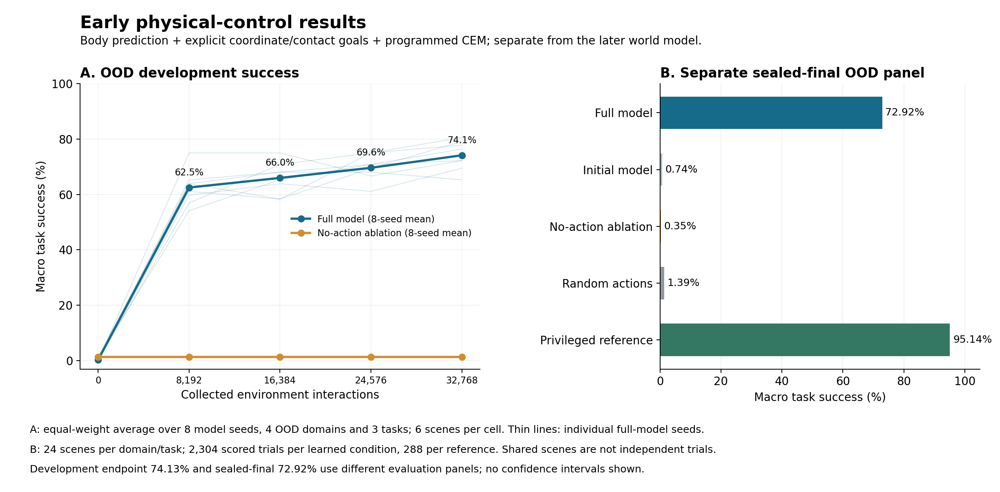

# DevBaby：全模拟物理学习与世界模型审计

[English](README.md) · 证据整理日期：**2026-11-11**

DevBaby 研究模型如何从全部模拟的视觉、动作、本体感觉、声音与养育者语音中学习物理交互。重点是新物理情境的成功率与学习速度，而不是语音识别成绩或意识判断。

**必须区分两代模型。** 早期身体预测控制器已经完成物理成功率与适应实验；后来的图像世界模型原型被发现存在训练缺陷。后者的补丁只通过单步机制验证，修复后的完整训练与泛化尚未验证。

## 当前结果

| 研究阶段 | 已核实观察 | 解释范围 |
|---|---|---|
| 早期身体预测 + 人工提供的 CEM 控制器 | OOD 开发成功率 0.35%→74.13%；独立封存 OOD 终点 72.92% | 有显式任务/空间目标和程序化抓取控制，不是自主物体级世界建模 |
| 早期适应补充实验 | 额外 2,048 次交互后：不更新 47.87%、全更新 38.85%、回放 44.79%、历史模型 59.29% | 8 个种子、该协议内的宏平均；简单反馈基线仍很强 |
| 随机探索 pilot | 12 条件 × 8 配对场景，接触与位移覆盖随策略变化 | 没有神经训练，尚未建立信息量或学习速度规律 |
| 后期冻结世界模型审计 | 物体预测差于图像 persistence；实际动作无一致优势 | 旧训练存在缺陷，只保留描述性故障证据 |
| 独立 200 步 FP32 对照 | 两种损失的开发集物体预测均差于 persistence | 单种子、小型已查看数据；不是操作成功率 |
| 参数与缓存审计 | 开缓存复现缺失梯度；关缓存恢复全部 8 个 GRU 张量更新 | 完整修复后 GradScaler/重试/恢复回归及重训尚未完成 |



图中左右面板来自不同评估集，两个终点不能拼成一条曲线。随机和特权参考没有独立训练种子。分母、区间、任务定义和强反馈基线详见[早期实验](docs/zh/EARLY_EXPERIMENTS.md)。

## 目前可以保留的结论

- 全模拟多模态采集与评估流程已经实现，物理/语言标注与模型输入分开保存。
- 早期有明确任务结构的身体控制系统能够学习并在有限物理变化中迁移；朴素继续适应可能降低成功率。
- 在补充协议中，旧经验回放部分缓解退化，显式历史基线优于主要 Baby 对照；尚未由此隔离出普遍因果机制。
- 后期训练缺陷已被复现，说明只检查总损失和总梯度会漏掉参数未训练。完整记录显示失败 GPU 条件下有 26 个张量缺失梯度，含 8 个循环和 18 个编码器张量。

目前不主张已发现 scaling law、普适物体操作能力、养育者语言的因果收益或意识。世界模型缓存补丁也不意味着独立 FP32 预测问题已解决。

## 文档导航

| 文档 | 中文 | English |
|---|---|---|
| 已完成的早期实验与适应研究 | [阅读](docs/zh/EARLY_EXPERIMENTS.md) | [Read](docs/en/EARLY_EXPERIMENTS.md) |
| 全部阶段的结果与结论 | [阅读](docs/zh/RESULTS.md) | [Read](docs/en/RESULTS.md) |
| 方法、标注边界与指标定义 | [阅读](docs/zh/METHODS.md) | [Read](docs/en/METHODS.md) |
| 训练缺陷与修复范围 | [阅读](docs/zh/TRAINING_BUG.md) | [Read](docs/en/TRAINING_BUG.md) |
| 进度与实验台账 | [阅读](docs/zh/PROGRESS.md) | [Read](docs/en/PROGRESS.md) |
| 局限与下一阶段实验 | [阅读](docs/zh/NEXT_STEPS.md) | [Read](docs/en/NEXT_STEPS.md) |

机器可读结果见[数据说明](results/README.md)；来源与访问范围见[溯源说明](provenance/README.md)；检查和提交步骤见 [CONTRIBUTING.md](CONTRIBUTING.md)。

## 复核本次整理

在本目录运行，Python 3.10+ 即可验证所附数据与表格，无需 GPU、网络或训练依赖：

```bash
python3 scripts/validate_results.py
python3 scripts/validate_early_stats.py
python3 scripts/validate_repository.py
```

只重建表格可运行 `python3 scripts/build_results.py --no-figures`。重建全部三张图：

```bash
python3 -m venv .venv-analysis
source .venv-analysis/bin/activate
python3 -m pip install -r requirements-analysis.txt
python3 scripts/build_results.py
python3 scripts/validate_results.py
```

这些命令不会训练模型或启动云作业。检查验证的是证据一致性，不是修复后优化器正确性。绘图渲染可能随环境变化；原始输入和数值表是复核依据。

## 本包范围

这是适合提交 GitHub 的文档与证据版本，包含双语报告、轻量原始结果、CSV、图表、源码摘要、历史源码包和精确梯度补丁。完整感官轨迹与模型权重仍保存在原私有结果仓库，本包未打包全部大文件。历史源码包包含已知缺陷，作为溯源材料保留，不是新发布的已验证训练版本。

本次整理没有启动新实验，也没有远程发布。文档包没有替项目指定开源许可证或 DOI。
