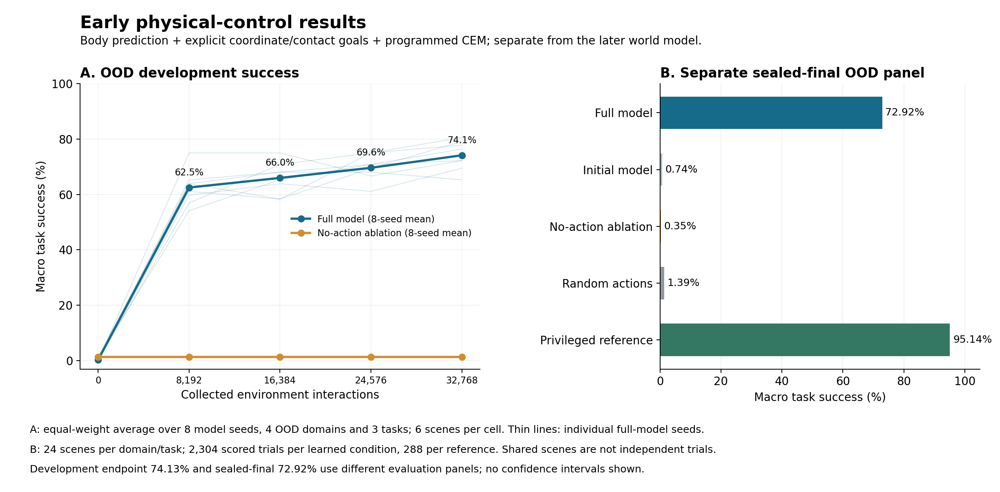
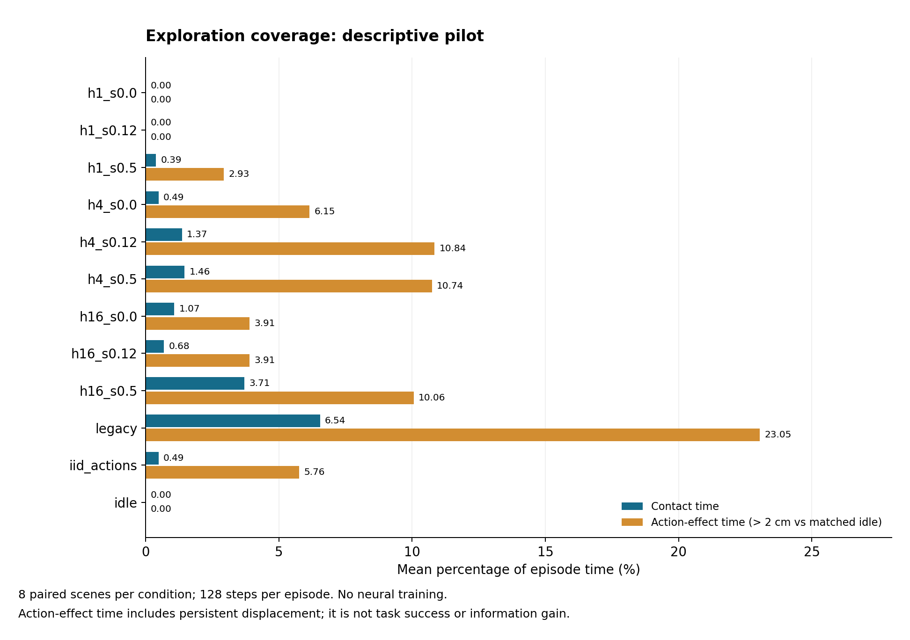
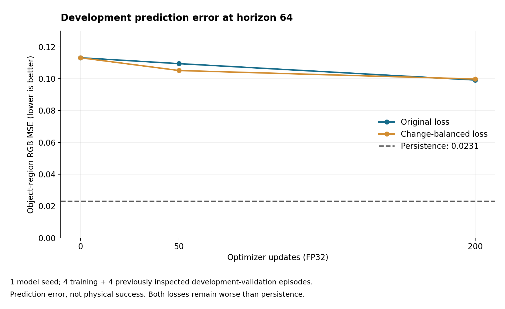

# Results and supported conclusions

[中文](../zh/RESULTS.md) · [Home](../../README.md)

**Early physical-control learning curves exist; completed repaired-world-model generalization curves do not.** These generations differ in tasks, goal interfaces, training and interpretation.

## 1. Early body prediction and physical control

Eight training seeds, explicit task/spatial goals and programmed planning/control. These are `full`-arm OOD developmental evaluations, excluding IID, over four shifted domains × three tasks with six paired scenes each: 576 scored seed–scene trials per age. Scenes repeat across model seeds; 576 is not the number of independent environments.

| Interactions / 交互量 | Successes / 成功次数 | Success / 成功率 |
|---|---|---|
| 0 | 2 / 576 | 0.35% |
| 8192 | 360 / 576 | 62.50% |
| 16384 | 380 / 576 | 65.97% |
| 24576 | 401 / 576 | 69.62% |
| 32768 | 427 / 576 | 74.13% |

The earlier independent sealed-endpoint OOD macro-average success rate is 72.92%, excluding IID. See [early experiments](EARLY_EXPERIMENTS.md) for domains, tasks, growth, controls and inference. These results support useful body-control mappings in that restricted system, not autonomous learning of an object-level world model from pixels.

In the supplement, after 2,048 extra interactions, macro-average success is 47.87% for frozen, 38.85% for full update, 44.79% for mixed replay and 59.29% for explicit history. Full update loses 9.03 percentage points against frozen; history gains 20.44 points over full update. These are results within the supplementary protocol, not laws of online learning.

A simple proprioceptive feedback baseline is strong. A new object-pushing task performs poorly under new dynamics and delay. The early evidence does not establish superiority over simple feedback control or general object-manipulation competence.

## 2. Random-exploration pilot: behavioral coverage, not learned success

12 conditions × eight paired initial scenes × 128 steps = 96 episodes and 12,288 steps. No neural training occurs. `h` retains the same sampled waypoint for a number of control steps; `s` is translational noise before clipping. `legacy` is the original correlated waypoint policy, `iid_actions` samples independent uniform actions, and `idle` issues zero actions.

| Condition / 条件 | Contact / 接触 | Action effect / 动作影响 |
|---|---|---|
| h1_s0.0 | 0.00% | 0.00% |
| h1_s0.12 | 0.00% | 0.00% |
| h1_s0.5 | 0.39% | 2.93% |
| h4_s0.0 | 0.49% | 6.15% |
| h4_s0.12 | 1.37% | 10.84% |
| h4_s0.5 | 1.46% | 10.74% |
| h16_s0.0 | 1.07% | 3.91% |
| h16_s0.12 | 0.68% | 3.91% |
| h16_s0.5 | 3.71% | 10.06% |
| legacy | 6.54% | 23.05% |
| iid_actions | 0.49% | 5.76% |
| idle | 0.00% | 0.00% |

Action-effect time is the fraction with at least one object displaced over 2 cm relative to the matched idle trajectory. It includes persistent displacement, not new information per step, mutual information or task success. Means are descriptive: scenes are few, contacts sparse and exploratory intervals uncorrected for multiple comparisons.

Means vary across persistence/noise combinations without a consistent monotonic noise relationship. The original `legacy` policy has the highest mean coverage in this pilot. The old world-model failure cannot simply be blamed on incoherent random actions. Clipping also changes realized action distributions relative to nominal noise settings.

The privileged reference succeeds in 7/8 relocation and 8/8 lifting trials. This checks feasibility only for these simple IID situations and is not a learned-agent score. Episode-level data and exploratory analyses are in `results/raw/pilot_*.json`.

Original world-model training coverage totals 4,096 episodes and 524,288 unique recorded transitions across eight seeds. Contact, holding and object-motion time fractions are 4.0535%, 3.9999% and 5.6427%. Per-seed records are in `results/raw/worldmodel_coverage/`. Timesteps are not independent statistical samples. These describe data coverage, not task success or an identified cause of training failure; the archived coverage file's suggestion that low coverage can explain failure is not an established causal finding.

## 3. Frozen world-model audit: affected by the training defect

Eight model seeds × four ages; eight new prediction episodes; four ranking scenes with eight candidates per scene. No training. The following uses old age-65,536 checkpoints. Lower MSE and higher distance advantage are better.

| Horizon / 时距 | Actual MSE | Zero MSE | Reversed MSE | Persistence MSE | Distance advantage / 距离优势 (m) |
|---|---|---|---|---|---|
| 8 | 0.118972 | 0.118400 | 0.119221 | 0.007303 | 0.000000 |
| 32 | 0.114887 | 0.114842 | 0.115235 | 0.018927 | 0.002802 |
| 64 | 0.115992 | 0.115188 | 0.115362 | 0.017557 | -0.007460 |

Actual actions do not consistently outperform mismatched inputs, and object prediction is worse than copying the initial image. Candidate ranking is not complete CEM task success. The 32 seed–scene rows contain only four distinct scenes. One candidate is privileged and serves solely as a positive control.

Predicted and actual pixel scores both add the same action-effort term. High untrained-model rank correlation may be confounded by that common term; this explanation has not been tested by removing/decomposing effort. It does not establish pre-existing planning competence.

These measurements describe an **implementation subsequently confirmed to have missing training gradients**. They do not show that random exploration, audio or world-model methods are ineffective, and these ages are not presented as a normal-training success curve.

## 4. 200-update FP32 loss comparison

The same random initialization and sampled batches compare the original image loss with a changed/unchanged-region balanced loss. One model seed, four training episodes, four previously inspected development-validation episodes, batch size four, 200 updates per treatment. This is neither untouched testing nor a control-performance experiment.

Development-validation object-region MSE under actual actions:

| Horizon / 时距 | Original FP32 | Change-balanced FP32 | Persistence |
|---|---|---|---|
| 1 | 0.126657 | 0.118363 | 0.002209 |
| 8 | 0.108761 | 0.109979 | 0.004338 |
| 32 | 0.101767 | 0.101104 | 0.024029 |
| 64 | 0.099145 | 0.099781 | 0.023146 |

At horizon 64 the original loss improves from 0.113136 to 0.099145, versus persistence at 0.023146; change-balanced training ends at 0.099781. Decreasing prediction error does not establish physical-task competence, and this comparison does not show a consistent balanced-loss advantage.

This training uses FP32 and bypasses the defective FP16-cache path. The cache patch does not automatically explain or solve its performance problem.

## 5. Parameter audit and repair mechanism

In old seed-0/1 checkpoints, all eight tensors in the two GRUs remain unchanged after 4,096 updates and have no optimizer state. Full records show another 18 encoder tensors are affected.

Matched GPU single-step tests update all 44 tensors in FP32. FP16 with cache on has 26 missing gradients. Cache-off restores finite gradients to all 44 tensors and updates 42, including all eight GRU tensors. No GradScaler is used, so this does not validate the complete training path. See [training defect](TRAINING_BUG.md).

## Interpretation boundary

Reportable findings include learning and deterioration in the earlier restricted controller, history/replay comparisons within its supplement, descriptive exploration coverage, and a reproducible training defect. Repaired-world-model generalization gains, causal effects of exploration randomness on learning speed, an effective-information law, scaling laws and consciousness remain unestablished.

See [result files](../../results/README.md) for sources and machine-readable evidence. The incomplete later world-model run is not a complete formal result set; planned trial counts are not reported as completed trials.
