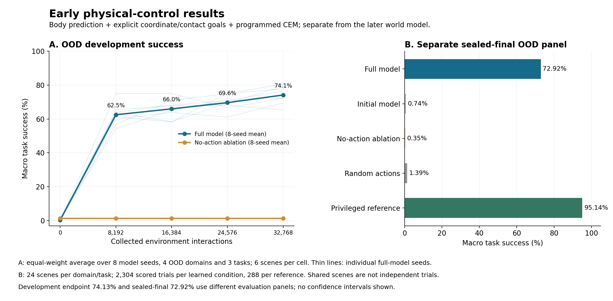
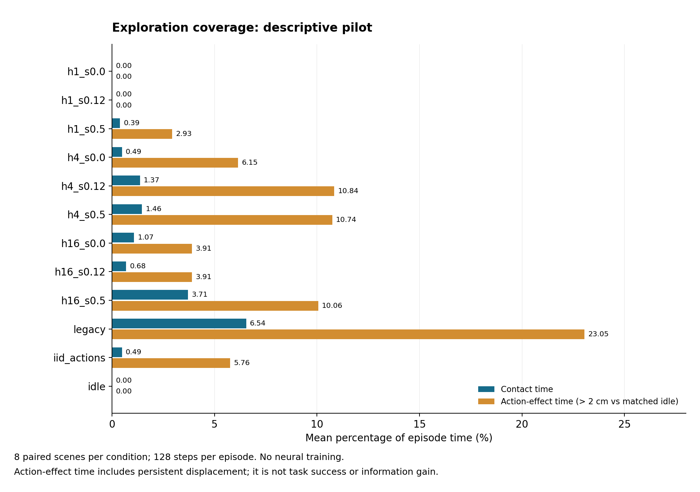
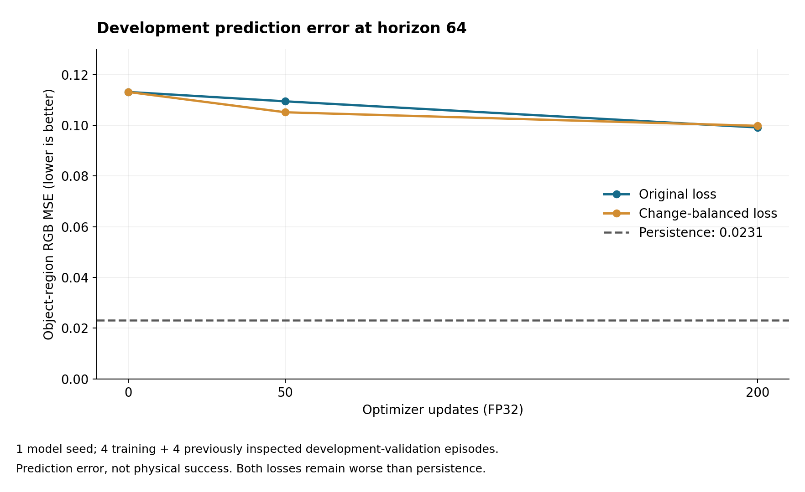

# 结果与可支持的结论

[English](../en/RESULTS.md) · [首页](../../README.zh-CN.md)

**已存在早期物理控制学习曲线，但后续修复后的世界模型尚无完成的泛化曲线。** 两代模型的任务、目标接口、训练过程和可解释范围不同。

## 1. 早期身体预测与物理控制

8 个训练种子，显式任务/空间目标与程序化规划控制。以下为 `full` 组 OOD 开发评估（不含 IID），包含固定的 4 个变化域 × 3 个任务，每组合 6 个配对情境，合计每年龄 576 个 seed–scene 评分项。不同模型种子复用场景，576 不是 576 个独立环境样本。

| Interactions / 交互量 | Successes / 成功次数 | Success / 成功率 |
|---|---|---|
| 0 | 2 / 576 | 0.35% |
| 8192 | 360 / 576 | 62.50% |
| 16384 | 380 / 576 | 65.97% |
| 24576 | 401 / 576 | 69.62% |
| 32768 | 427 / 576 | 74.13% |

早期独立封存终点的 OOD 宏平均成功率为 72.92%（不含 IID）。具体域、任务、增长速度、对照与推断见[早期实验](EARLY_EXPERIMENTS.md)。这些结果支持该受限系统学到了有用的身体控制映射，不能等同于从像素自主学习物体级世界模型。

补充实验中，在额外 2,048 次交互后，冻结模型、全参数更新、混合重放和显式历史模型的宏平均成功率分别为 47.87%、38.85%、44.79%、59.29%。全参数更新相对冻结下降 9.03 个百分点；history 相对全参数更新提高 20.44 个百分点。这些是该补充协议中的结果，不能推广为所有在线学习的定律。

简单本体反馈基线很强；新推物体任务在新动力学/延迟条件下表现差。早期结果并未证明神经模型胜过简单反馈控制器或具备普适物体操作能力。

## 2. 随机探索 pilot：行为覆盖，不是学习成功率

12 条件 × 8 配对初始场景 × 128 步 = 96 回合、12,288 步。没有神经网络训练。`h` 是保持同一随机目标点的控制步数；`s` 是截断前平移噪声标准差。`legacy` 是原先带相关性的随机目标策略，`iid_actions` 每步独立均匀采样，`idle` 为零动作。

| Condition / 条件 | Contact / 接触 | Action effect / 动作影响 |
|---|---|---|
| h1_s0.0 | 0.00% | 0.00% |
| h1_s0.12 | 0.00% | 0.00% |
| h1_s0.5 | 0.39% | 2.93% |
| h4_s0.0 | 0.49% | 6.15% |
| h4_s0.12 | 1.37% | 10.84% |
| h4_s0.5 | 1.46% | 10.74% |
| h16_s0.0 | 1.07% | 3.91% |
| h16_s0.12 | 0.68% | 3.91% |
| h16_s0.5 | 3.71% | 10.06% |
| legacy | 6.54% | 23.05% |
| iid_actions | 0.49% | 5.76% |
| idle | 0.00% | 0.00% |

动作影响定义为相对同初始场景 idle 轨迹至少一个物体偏移超过 2 cm 的时间占比。它包含持续位移，不是每步新增信息、互信息或任务成功率。均值仅作描述；场景少、接触稀疏，探索性区间未校正多重比较。

观察到的均值随保持时间与噪声组合变化，未出现一致的单调噪声规律。原 `legacy` 策略的均值最高，因此不能将旧世界模型失败简单归因于“随机动作不连贯”。名义噪声经过动作截断，实际动作分布也必须检查。

特权参考控制器搬移 7/8、抬起 8/8，只验证这批 IID 简单情境的可行性，不计入学习模型成绩。完整 episode 级数据和探索性分析见 `results/raw/pilot_*.json`。

原世界模型训练数据覆盖汇总：8 个种子共 4,096 回合、524,288 次唯一采集转移；接触、抓持、物体运动的时间占比分别为 4.0535%、3.9999%、5.6427%。原始逐种子记录在 `results/raw/worldmodel_coverage/`。时间步不是独立统计样本。这些是数据覆盖描述，不是任务成功率，也不能单独确定训练失败原因；原记录中关于覆盖“解释失败”的文字不能当作已经识别的因果结论。

## 3. 冻结世界模型审计：受训练缺陷影响

8 个模型种子 × 4 个年龄；新增 8 段预测经历；4 个候选排序场景，每场景 8 个候选。没有训练。下表为旧模型年龄 65,536，MSE 越低越好，距离优势越大越好。

| Horizon / 时距 | Actual MSE | Zero MSE | Reversed MSE | Persistence MSE | Distance advantage / 距离优势 (m) |
|---|---|---|---|---|---|
| 8 | 0.118972 | 0.118400 | 0.119221 | 0.007303 | 0.000000 |
| 32 | 0.114887 | 0.114842 | 0.115235 | 0.018927 | 0.002802 |
| 64 | 0.115992 | 0.115188 | 0.115362 | 0.017557 | -0.007460 |

实际动作相对错误动作输入没有一致优势；物体区域预测明显落后于起点图像 persistence。候选排序不等于完整 CEM 操作成功率；32 个 seed–scene 行只有 4 个不同场景。候选含一个特权参考轨迹，仅作正对照。

模型预测评分和真实像素评分均加入相同动作 effort 项。未训练模型的较高排序相关性可能受到该共同项影响；该解释尚未通过去除 effort 的分解实验验证，不能作为模型已有规划能力的证据。

这些数据描述了**后来确认存在梯度缺陷的旧训练实现**。不能据此判定随机探索、声音输入或世界模型方法本身无效，也不报告这些年龄点为正常学习的成功曲线。

## 4. 200 步 FP32 损失对照

同一随机初始化、相同采样批次，分别使用原图像损失与变化/不变区域均衡损失。单个模型种子，4 段训练经历、4 段已查看的开发验证经历，批量 4，每组 200 次更新。不是未触碰测试集，不是控制实验。

下表是开发验证集实际动作条件下的物体区域 MSE：

| Horizon / 时距 | Original FP32 | Change-balanced FP32 | Persistence |
|---|---|---|---|
| 1 | 0.126657 | 0.118363 | 0.002209 |
| 8 | 0.108761 | 0.109979 | 0.004338 |
| 32 | 0.101767 | 0.101104 | 0.024029 |
| 64 | 0.099145 | 0.099781 | 0.023146 |

64 步原损失从 0.113136 降至 0.099145，但 persistence 为 0.023146；变化均衡损失的终点为 0.099781。图中下降不意味着获得物理任务能力，也没有显示均衡损失带来稳定优势。

这组训练使用 FP32，不经过有问题的 FP16 缓存路径。它的性能问题不能由缓存补丁自动解释或视为解决。

## 5. 参数审计与修复机制

seed 0/1 的旧检查点中，两个 GRU 的 8 个张量在 4,096 次更新后均未变化，且无 optimizer state。完整记录还显示 18 个 encoder 张量同受影响。

匹配 GPU 单步实验：FP32 的 44 个参数张量均更新；FP16 缓存开启时 26 个缺失梯度；关闭缓存后 44 个均有有限梯度、42 个更新，两个 GRU 的 8 个均恢复更新。未使用 GradScaler；不能据此宣称完整训练路径通过。详见[缺陷与修复](TRAINING_BUG.md)。

## 结论边界

可以报告早期受限控制系统的学习和退化、补充协议中的历史/重放比较、探索覆盖描述，以及可复现的训练缺陷。尚不能报告修复后的世界模型泛化提升、探索随机性对学习速度的因果机制、有效信息定律、scaling law 或意识。

所有当前表格来源与机器可读证据见[结果文件](../../results/README.md)。旧世界模型主运行的未完成评估不是一套完整的正式结果；本包没有把计划试验量计为已执行试验量。
